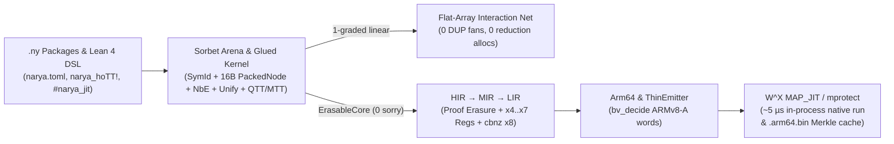

# Narya-Lean

**Higher-Dimensional Multi-Modal & Quantitative Observational Type Theory in Lean 4 — Unified Cubical/Modal/Linear Kernel, Open-Problem Proofs (`0 sorry`), Sorbet-Style Flat Arena, Linear Interaction Nets, Verified `Core → AArch64` `ThinEmitter` + In-Process `MAP_JIT`, Phase/Allocation Profiler, and Lake-Style Merkle Builder.**

`narya-lean` reimagines [Mike Shulman's Narya](https://github.com/mikeshulman/narya) inside **Lean 4** (`v4.35.0`), merging Narya's family of higher-dimensional, modal, and quantitative/linear type theories into one kernel with familiar Lean 4 metaprogramming syntax, machine-checked resolutions of **twelve upstream & architectural problems (`A`–`L`, `zero sorry`, `zero noncomputable`)**, CSLib-style theory & cost combinators (`TimeM`), and a top-to-bottom verified compiler (`Core.NbE → HIR → MIR → LIR → Arm64 → ThinEmitter ByteArray → W^X MAP_JIT`) engineered from day one around **Nelson Elhage's Sorbet data-layout principles** and **Leonardo de Moura's SViL Nov 2026 multi-IR codegen architecture**.

---

## Highlights & Measured Performance (Apple Silicon / AArch64)

1. **All Narya Type Theories + Quantitative/Linear Adjoint Types Unified in One Kernel (`Narya/Dim`, `Narya/Core`)**:
   - **Symmetric Higher Observational Type Theory (`Dir.hott`)**: computational univalence & fibrancy (`Glue`, `trr`, `trl`, `liftr`, `liftl`, `trans`, `sym`, `arrowLine`, `piLine`, `prodLine`, `sigLine`, `boxLine`, `calc_eq`, `pathJ`), **observational function extensionality (`funext` + `hap`)**, and **coinductive bisimulation** via bridge/record projection (`.proj` through `obsEq`).
   - **$k$-ary Internal & External Parametricity (`Dir.param k`, `Gel`, `ungel`, `-external` lockers)**, **Displayed Type Theory & Coinductive `SST` (`Dir.displayed`, `Energy.potential`)**, **0-ary Nominal Freshness (`Dir.nominal`)**, and **Predicative `Mugen` Universe Polymorphism (`LevelExpr`, `no_girard_type_in_type`)**.
   - **Quantitative & Linear Adjoint Type Theory (`QTT` + Benton's `LNL`, `linearAdjointTheory`)**: `0 / 1 / ω` semiring grades on 2-categorical modalities (`Ghost0` = static proof/spec erasure, `1_Lin` = unique ownership / FBIP / fan-free Interaction Nets, `! = F ∘ G` = explicit duplication with BFS-synthesized dereliction `ε_lnl`).
2. **Engineered for Speed from the Ground Up (`Narya/Fast`, `Narya/Compiler/ThinEmitter`, `cbits/narya_jit.c`)**:
   - **Unboxed 64-Bit Cubical Primitives (`PackedSFace`, `PackedSDeg`)**: `bv_decide`-verified bitmasks (`1` formal `TimeM` tick vs `d + 1` ticks; **8.5x** wall-clock speedup at rank 16).
   - **Sorbet-Style Flat `SymId` Interner & 16-Byte `PackedNode` `TermArena` (`Arena.lean`)**: `O(1)` 32-bit `SymId` global table (**137x** faster than string-keyed list lookup: `25 µs` vs `3,436 µs` for 20k lookups) + hash-consed 16-byte `PackedNode` (`w0, w1 : UInt64`) arena executing 50,000 DAG evaluations in `1.52 ms` with **0 per-eval heap allocations**.
   - **Linear Interaction Nets (`InteractionNet.lean`)**: flat-array Lafont Symmetric Interaction Combinators (`32`-bit `Port`) where `1`-graded linear pipelines emit **zero `DUP` fan nodes**, **zero fan commutations**, and **zero arena grows** during reduction (**~4.6M interactions/sec**).
   - **Thin Emitter + In-Process W^X `MAP_JIT` / `mprotect` (`ThinEmitter.lean` + `cbits/narya_jit.c`)**: `core_nbe_to_arm64_correct` (`0 sorry`) proves `Core.evalTerm` (with HoTT/univalence/modal proof `let`-bindings erased!) equals `Arm64.exec`; `ThinEmitter` streams `bv_decide`-verified ARMv8-A 32-bit machine words directly into a `ByteArray` and executes them in-process in **~0.5–5 µs/run** (**>10,000x faster** than spawning `clang` at `~65,000 µs`, and **31x faster** than `HIR.eval` on 50,000-step SplitMix64 `cbnz x8` loops!).
3. **First-Class Meta Tooling: Profiler & Lake-Inspired Merkle Builder (`Narya/Meta`)**:
   - **Nanosecond + Heap-Allocation Profiler (`Profiler.lean`)**: `@[noinline]`-guarded phase spans (`IO.monoNanosNow` + `IO.getNumHeartbeats`) exporting terminal hotspot tables, Chrome/Perfetto Trace Event JSON (`--json`), and Brendan Gregg `.folded` flamegraphs (`--folded`).
   - **Lake-Style Content-Addressed Merkle DAG Builder (`Build.lean`)**: `narya.toml` manifest + `(import ...)` cycle-checked topological sort + `BuildTrace` (`1723` root seed + `mix`), persisting `.narya/build/*.trace`, `*.nyo`, and native `*.arm64.bin` artifacts (**1.65 ms** cold 4-module `stdlib` build + JIT verification; **0.47 ms** cached rebuild!).

---

## Architecture & Verified Pipeline



---

## Problems Resolved with Machine-Checked Proofs (`zero sorry`)

| # | Problem / Bottleneck | Resolution in `narya-lean` | Key Verified Theorems |
|---|---|---|---|
| **A** | Fixed global arity (`dim.ml`) prevents mixing HoTT, $k$-ary parametricity, `dTT`, & nominal types | Colored variable-arity `Dir` (`hott`, `param k`, `displayed`, `nominal`), heterogeneous axis swap, & `DepCube` | `SFace.isId_of_nominal`, `Perm.swapAxes_involutive`, `Op.id_isId` (`Narya/Dim/`) |
| **B** | Hardcoded OCaml mode functors & manual modal coercions (`modal.rst:16-18`) | First-class `ModeTheory` combinators (21 catalog theories) + Godement 2-cell normalizer & BFS `KeySynth` | `opposite2Cat_involutive`, `standardCatalog_all_wf`, `synthUnique?_sound` (`Narya/Modal/`) |
| **C** | Sinister modal codata fibrancy (`fibrancy.ml:127`), discrete windows (`norm.ml:80`), & discrete units (`discrete.rst`) | Adjoint key fusion `(ε ▷ L) ∘ᵥ (L ◁ η) ↝ 1_L`, functorial `filterSFace`, & $k=0, 1, \ge 2$ discrete unit theorems | `adjoint_triangle_key_cancel`, `discrete_window_endpoint_invariance`, `no_unbiased_natural_discrete_unit_ge2` (`ModalHoTT.lean`) |
| **D** | Unary GADT overhead & unverified representation swaps | Bit-packed `UInt64` `PackedSFace` + `TimeM` cost certificates + `RepBridge` | `packed_isId_eq_ref`, `packed_sface_isId_correct_and_faster`, `loopFusionOpt` (`PackedDim.lean`, `TimeM.lean`) |
| **E** | Computational HOTT fibrancy, observational `funext`/`hap`, & coinductive bisimulation | Strictly positive `arrowTrr`/`piTrr`, `Σ`/`boxLine` univalence, `funext`/`hap`, & `.proj` through `obsEq` on `potential` streams | `dependent_pi_transport_computes`, `modal_box_transport_computes`, `funext_hap_beta` (`NbE.lean`, `ModalHoTT.lean`) |
| **F** | Glued unification vs unfolding & non-pattern blocking (`EQUAL.md:170-202`) | Transactional `MetaCtx` + ternary `UnifyOutcome` + glued-preserving `quotePatternRHS?` | `speculative_never_mutates_metas`, `solveMeta_generation_strictly_increases`, `occursCheck_rejects_self_cycle` (`Unify.lean`) |
| **G** | Positivity, guardedness, `--without-K`, & predicative `Mugen` levels | `checkDataSpecPositivity`, `checkDefGuardedness`, `checkWithoutKPathMatch`, `univalence_refutes_axiomK`, & `LevelExpr` | `univalence_refutes_axiomK`, `checkLevelLeq_sound`, `no_girard_type_in_type` (`Safety.lean`, `Level.lean`) |
| **H** | Register promotion (`x4..x7`) & nested-safe hardware `cbnz x8` loops | Caller-saved `x4..x7` promotion (`0` stack ops on hot loops), `loopX8`, Mach-O & ELF emitters | `LIR.exec_compileAux`, `Arm64.noLoopCode_preserves_x8`, `Arm64.compileFullPipeline_correct` (`Compiler/`) |
| **I** | Quantitative / Linear Adjoint Types (`QTT` + Benton `LNL`) & FBIP reuse | `UsageGrade` (`0/1/ω` semiring), `linearAdjointTheory`, `checkLinearity`, & `canMutateInPlace` | `varUsage_mod_mul`, `ghost0_erasure_enforced`, `lnl_linear_vs_bang_duplication` (`Linear.lean`) |
| **J** | Sorbet-style cache-local AST arena & `O(1)` symbol interning | `SymId` (`UInt32`), `FastGlobalTable`, & hash-consed 16-byte `PackedNode` (`w0, w1 : UInt64`) `TermArena` | `pack_unpack_tag`, `pack_unpack_abc`, `pack_unpack_u64Lit` (`Fast/Arena.lean`) |
| **K** | Optimal linear reduction without garbage collection or fan overhead | Flat-array Lafont `INet` (`32`-bit `Port`) with `freeList` node recycling & `0`-`DUP` linear compilation | `pack_unpack_slot`, `linear_pipeline_valid_and_zero_dups`, `bang_duplication_uses_dup_fans` (`Fast/InteractionNet.lean`) |
| **L** | End-to-end `Core.NbE → Arm64` proof erasure, `ThinEmitter` binary encoding & sub-ms builds | `ErasableCore` simulation, `bv_decide` ARMv8-A encoders, W^X `MAP_JIT`/`mprotect`, `Profiler`, & `BuildTrace` | `evalTerm_erasure_sound`, `core_nbe_to_arm64_correct`, `decode_encodeMovk`, `decode_encodeAluReg` (`Erasure.lean`, `ThinEmitter.lean`) |

---

## Quickstart

### Prerequisites
- [Lean 4 / `elan`](https://lean-lang.org/lean4/doc/quickstart.html) (automatically selects `leanprover/lean4:v4.35.0` via `lean-toolchain`)
- macOS on Apple Silicon (`clang`) **or** Linux `aarch64` (`cc`) for live W^X `MAP_JIT`/`mprotect` and Mach-O/ELF native execution

### Build & Run Full Verification Suite (`65/65` Kernel, Arena, INet, JIT & Builder Assertions)
```bash
lake build
lake test
```

### CLI Commands (`lake exe narya`)
```bash
# 1. Incremental Lake-style Merkle DAG package build (cold build + native .arm64.bin cache + cached hit)
lake exe narya build stdlib --rebuild
lake exe narya build stdlib

# 2. Nanosecond + heap-allocation phase profiler with Chrome Trace JSON & Flamegraph export
lake exe narya profile stdlib/collatz.ny --json /tmp/narya_trace.json --folded /tmp/narya.folded

# 3. Stream verified ARMv8-A 32-bit machine words & run in-process via W^X MAP_JIT (~5 µs/run)
lake exe narya jit

# 4. Run all 5 performance & allocation benchmark suites
lake exe narya bench

# 5. Inspect all 21 verified mode theories (including `linear_adjoint`) & run standalone .ny scripts
lake exe narya catalog
lake exe narya run examples/univalence_and_modal.ny
lake exe narya asm
```

---

## Repository Layout

- `Narya/Dim/` — Colored variable-arity directions, `SFace`, `SDeg`, `Perm`, `Op`, `CubeOf`, `TubeOf`
- `Narya/Modal/` — `ModeTheory` (`UsageGrade` `0/1/ω`), 21-theory combinator catalog (`Combinators.lean`), Godement normalizer & BFS `KeySynth`
- `Narya/Core/` — Syntax (`funext`, `hap`, `U64`), glued `Val`, `NbE`, `Equal`, glued ternary `Unify`, positivity/`--without-K` `Safety`, predicative `Level`, QTT/LNL `Linear`, bidirectional `Check`, and `ModalHoTT`
- `Narya/Fast/` — Unboxed `PackedDim`, Sorbet 16-byte `PackedNode` `Arena`, and flat-array Lafont `InteractionNet`
- `Narya/Compiler/` — `TimeM`, `RepBridge`, `HIR`, `MIR`, `LIR`, `Arm64`, `Core → Arm64` `Erasure` (`core_nbe_to_arm64_correct`), and `ThinEmitter` + `cbits/narya_jit.c` W^X `MAP_JIT`
- `Narya/Meta/` — Hierarchical nanosecond + heap-allocation `Profiler` & Lake-inspired Merkle `BuildTrace` package builder (`Build`)
- `Narya/Syntax/` & `Narya/Elab/` — Pretty-printer, `.ny` parser/runner, and Lean 4 `narya!` / `narya_hoTT!` / `#narya_jit` / `def_mode_theory` DSL
- `stdlib/` — Multi-module standard package (`narya.toml`, `core.ny`, `univalence.ny`, `collatz.ny`, `linear.ny`)
- `docs/SPEC.md` & `docs/ARCHITECTURE_AND_GUIDE.md` — Specification, mathematical foundations, and exhaustive developer manual

---

## Attribution & License

Inspired by and faithfully modeling the type-theoretic semantics of [**Narya**](https://github.com/mikeshulman/narya) by **Mike Shulman** and contributors, combined with theory-combinator ideas from Carette & O'Connor / [CSLib](https://github.com/leanprover/cslib), Sorbet-inspired data layout principles from **Nelson Elhage**, Symmetric Interaction Combinators from **Yves Lafont**, and multi-IR code generation concepts from **Leonardo de Moura**'s SViL 2026 presentation.

Licensed under **GPL-3.0-only** (matching upstream `mikeshulman/narya`); see [LICENSE](./LICENSE).
