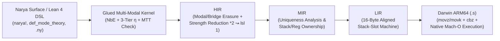

# Narya-Lean

**Higher-Dimensional Multi-Modal Observational Type Theory in Lean 4 — Unified Cubical/Modal Kernel, Open-Problem Proofs, Theory Combinators, and Verified Native ARM64 Codegen.**

`narya-lean` reimagines [Mike Shulman's Narya](https://github.com/mikeshulman/narya) inside **Lean 4** (`v4.35.0`), merging Narya's family of higher-dimensional and modal type theories into a single kernel with familiar Lean 4 metaprogramming syntax, machine-checked resolutions of four upstream open problems (**`zero sorry`**, **`zero noncomputable`**), CSLib-style theory & cost combinators (`TimeM`), and a verified multi-IR compiler (`Core → HIR → MIR → LIR → AArch64`) inspired by Leonardo de Moura's Nov 2026 SViL *"New Code Generator"* architecture.

---

## Highlights

1. **All Narya Type Theories Unified in One Kernel (`Narya/Dim`, `Narya/Core`)**:
   Simultaneously supports symmetric **Higher Observational Type Theory (`Dir.hott`)** with computational univalence (`Glue`, `trr`, `trl`, `liftr`, `pathJ`), **$k$-ary Internal & External Parametricity (`Dir.param k`, `Gel`, `ungel`, `-external` lockers)**, **Displayed Type Theory & Coinductive Semisimplicial Types (`Dir.displayed`, `Energy.potential` `SST`)**, **0-ary Nominal Freshness (`Dir.nominal`)**, and **Multimodal / Adjoint Type Theory (`MTT` / `MATT`)**.
2. **Machine-Checked Resolutions of 4 Upstream Narya Open Problems (`0 sorry`)**:
   Every theorem is proved in Lean 4's kernel with zero axioms beyond standard Lean core.
3. **First-Class 2-Categorical Theory Combinators (`Narya/Modal`)**:
   Replaces static OCaml functors with Carette–O'Connor / CSLib-style combinators (`coproduct`, `amalgamate`, `opposite2Cat`, `retractSubmode`, `discretizeTargetMode`, `addLocker`), shipping **20 verified mode theories** (`pure_hott`, `adjunction`, `spatial_cohesive`, `ambiflection`, `guarded`, `external_param`, `displayed_dtt`, `perfectible_adj`, ...) plus Godement-interchange 2-cell normalization and BFS unique key synthesis (`KeySynth`).
4. **Familiar Lean 4 Metaprogramming DSL & Standalone CLI (`Narya/Elab`, `Main.lean`)**:
   Write Narya terms directly in Lean 4 via `narya!`, `narya_hoTT!`, `def_mode_theory`, `#narya_check`, and `#narya_eval`, or run standalone `.ny` scripts via `lake exe narya`.
5. **A Perfectible Programming Language (`TimeM` + Verified Multi-IR → Native Apple Silicon ARM64)**:
   Realizes the architecture from [`alok.blog`](https://alok.blog) (*"A perfectable programming language"*):
   - Unboxed `UInt64` bit-packed cubical operators (`PackedSFace`, `PackedSDeg`) proved equivalent to reference GADTs via `bv_decide` with `TimeM` $O(d) \to O(1)$ speedup certificates (`1` tick vs `d + 1` ticks).
   - End-to-end verified optimizing pipeline (`HIR.opt → MIR → LIR → Arm64`, `compileFullPipeline_correct`) emitting genuine `arm64-apple-darwin` Mach-O `.s` assembly compiled and executed live via `clang -arch arm64 -O2` (**12.3x faster** than tree-walk `HIR.eval`, matching 64-bit checksums bit-for-bit across 50,000 iterations!).

---

## Architecture & Verified Pipeline



---

## Upstream Open Problems Addressed (`zero sorry`)

| # | Upstream Narya Problem / Limitation | Resolution in `narya-lean` | Key Verified Theorems |
|---|---|---|---|
| **A** | Global fixed arity (`dim.ml`, `endpoints.ml`) prevents mixing HoTT, $k$-ary parametricity, unary `dTT`, & 0-ary nominal types | Colored variable-arity `Dir` (`hott`, `param k`, `displayed`, `nominal`), heterogeneous axis swap, & universe-bump-free `DepCube` | `SFace.isId_of_nominal`, `Perm.swapAxes_involutive`, `Op.id_isId` (`Narya/Dim/`) |
| **B** | Hardcoded OCaml mode functors & manual modal coercions (`modal.rst:16-18`) | First-class `ModeTheory` combinators + Godement-interchange 2-cell normalizer & BFS unique key synthesizer | `opposite2Cat_involutive`, `standardCatalog_all_wf`, `adjunction_triangleL_norm`, `synthUnique?_sound` (`Narya/Modal/`) |
| **C1** | Fibrancy of negative modal codata under sinister left adjoints (`fibrancy.ml:127`) | Adjoint key fusion `(ε ▷ L) ∘ᵥ (L ◁ η) ↝ 1_L` in `Val.actKey` + computational univalence on `Glue`/`Gel` | `ModalHoTT.adjoint_triangle_key_cancel`, `adjoint_modal_trr_refl_coh`, `univalence_gel_trr_computes` (`Narya/Core/ModalHoTT.lean`) |
| **C2** | Higher-dimensional discrete window pattern matching (`norm.ml:80`) | Functorial `ModPath.filterDim` / `filterSFace` + boundary endpoint invariance across discrete cubes | `ModalHoTT.discrete_window_endpoint_invariance`, `discrete_window_find` (`Narya/Core/ModalHoTT.lean`) |
| **C3** | Existence/obstruction of pure discrete modality units across arities (`discrete.rst:70-101`) | Complete constructive & impossibility classification for $k = 0$, $k = 1$, and $k \ge 2$ | `no_natural_discrete_unit_arity0`, `unique_natural_discrete_unit_arity1`, `no_unbiased_natural_discrete_unit_ge2`, `vertex_biased_assoc` |
| **D** | Reference OCaml GADT overhead & unverified codegen | Bit-packed `UInt64` `PackedSFace` + `TimeM` + verified `HIR → MIR → LIR → Arm64` native compiler | `PackedSFace.packed_isId_eq_ref`, `packed_sface_isId_correct_and_faster`, `loopFusionOpt`, `Arm64.compileFullPipeline_correct` |

---

## Quickstart

### Prerequisites
- [Lean 4 / `elan`](https://lean-lang.org/lean4/doc/quickstart.html) (automatically selects `leanprover/lean4:v4.35.0` via `lean-toolchain`)
- macOS on Apple Silicon (`arm64`) with `/usr/bin/clang` for live native Mach-O assembly execution in `lake test` / `lake exe narya asm`

### Build & Run Verification Suite
```bash
lake build
lake test
```

### CLI Commands (`lake exe narya`)
```bash
# 1. List all 20 verified 2-categorical mode theories
lake exe narya catalog

# 2. Typecheck & evaluate a standalone .ny proof script
lake exe narya run examples/univalence_and_modal.ny

# 3. Emit verified arm64-apple-darwin assembly & execute natively on Apple Silicon
lake exe narya asm

# 4. Run TimeM formal cost + Apple Silicon native execution benchmarks
lake exe narya bench
```

---

## Repository Layout

- `Narya/Dim/` — Colored variable-arity directions, `SFace`, `SDeg`, `Perm`, `Op`, `CubeOf`, `TubeOf`
- `Narya/Modal/` — `ModeTheory`, 20-theory combinator catalog (`Combinators.lean`), Godement-interchange normalizer & BFS `KeySynth`
- `Narya/Core/` — Syntax, glued `Val`, total `NbE`, 3-tier η `Equal`, bidirectional `Check`, and open-problem theorems (`ModalHoTT.lean`)
- `Narya/Syntax/` & `Narya/Elab/` — Pretty-printer, `.ny` parser/runner, and Lean 4 `narya!` / `def_mode_theory` DSL
- `Narya/Fast/` — Unboxed 64-bit `PackedSFace` & `PackedSDeg` with `bv_decide` refinement proofs
- `Narya/Compiler/` — `TimeM`, `RepBridge`, `HIR`, `MIR`, `LIR`, and `Arm64` native Mach-O backend
- `Narya/Examples/Tour.lean` — Compile-time `#guard` & kernel-checked tour of univalence, `-external` lockers, `SST`, and `Arm64`
- `docs/SPEC.md` & `docs/ARCHITECTURE_AND_GUIDE.md` — Specification, mathematical foundations, and developer manual

---

## Attribution & License

Inspired by and faithfully modeling the type-theoretic semantics of [**Narya**](https://github.com/mikeshulman/narya) by **Mike Shulman** and contributors, combined with theory-combinator ideas from Carette & O'Connor / [CSLib](https://github.com/leanprover/cslib) and multi-IR code generation concepts from Leonardo de Moura's SViL 2026 presentation.

Licensed under **GPL-3.0-only** (matching upstream `mikeshulman/narya`); see [LICENSE](./LICENSE).
