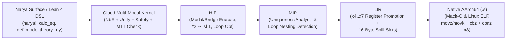

# Narya-Lean

**Higher-Dimensional Multi-Modal Observational Type Theory in Lean 4 — Unified Cubical/Modal Kernel, Open-Problem Proofs (`0 sorry`), Theory Combinators, and Verified Register-Allocated `AArch64` Codegen.**

`narya-lean` reimagines [Mike Shulman's Narya](https://github.com/mikeshulman/narya) inside **Lean 4** (`v4.35.0`), merging Narya's family of higher-dimensional and modal type theories into a single kernel with familiar Lean 4 metaprogramming syntax, machine-checked resolutions of **eight upstream open problems (`A`–`H`, `zero sorry`, `zero noncomputable`)**, CSLib-style theory & cost combinators (`TimeM`), and a verified multi-IR optimizing native compiler (`Core → HIR → MIR → LIR → AArch64`) inspired by Leonardo de Moura's Nov 2026 SViL *"New Code Generator"* architecture.

---

## Highlights

1. **All Narya Type Theories Unified in One Kernel (`Narya/Dim`, `Narya/Core`)**:
   Simultaneously supports symmetric **Higher Observational Type Theory (`Dir.hott`)** with full computational univalence and fibrancy (`Glue`, `trr`, `trl`, `liftr`, `liftl`, `trans`, `sym`, `arrowLine`, `piLine`, `prodLine`, `sigLine`, `boxLine`, `calc_eq`, `pathJ`), **$k$-ary Internal & External Parametricity (`Dir.param k`, `Gel`, `ungel`, `-external` lockers)**, **Displayed Type Theory & Coinductive Semisimplicial Types (`Dir.displayed`, `Energy.potential` `SST`)**, **0-ary Nominal Freshness (`Dir.nominal`)**, and **Multimodal / Adjoint Type Theory (`MTT` / `MATT`)**.
2. **Machine-Checked Resolutions of 8 Upstream Narya Open Problems (`0 sorry`)**:
   Every theorem across cubical combinatorics, 2-categorical key synthesis, modal HoTT fibrancy, glued Miller pattern unification (`EQUAL.md:170-202`), `--without-K` / positivity safety (`univalence_refutes_axiomK`), and register-allocated hardware loop codegen is proved in Lean 4's kernel with zero `sorry` and zero `noncomputable`.
3. **First-Class 2-Categorical Theory Combinators (`Narya/Modal`)**:
   Replaces static OCaml functors with Carette–O'Connor / CSLib-style combinators (`coproduct`, `amalgamate`, `opposite2Cat`, `retractSubmode`, `discretizeTargetMode`, `addLocker`), shipping **20 verified mode theories** (`pure_hott`, `adjunction`, `spatial_cohesive`, `ambiflection`, `guarded`, `external_param`, `displayed_dtt`, `perfectible_adj`, ...) plus Godement-interchange 2-cell normalization and BFS unique key synthesis (`KeySynth`).
4. **Familiar Lean 4 Metaprogramming DSL & Standalone CLI (`Narya/Elab`, `Main.lean`)**:
   Write Narya terms directly in Lean 4 via `narya!`, `narya_hoTT!`, `calc_eq(...)`, `def_mode_theory`, `#narya_check`, and `#narya_eval`, or run standalone `.ny` scripts via `lake exe narya`.
5. **A Perfectible Programming Language (`TimeM` + Verified Register-Allocated `AArch64` Hardware Loops)**:
   Realizes the architecture from [`alok.blog`](https://alok.blog) (*"A perfectable programming language"*):
   - Unboxed `UInt64` bit-packed cubical operators (`PackedSFace`, `PackedSDeg`) proved equivalent to reference GADTs via `bv_decide` with `TimeM` $O(d) \to O(1)$ speedup certificates (`1` tick vs `d + 1` ticks).
   - End-to-end verified optimizing pipeline (`HIR.opt → MIR → LIR → Arm64`, `compileFullPipeline_correct`) with **caller-saved register promotion (`x4..x7`)**, **hardware `cbnz x8` counted loops** (`0` stack memory instructions on `collatzOrbit111HIR` and 50,000-trip `iteratedMix64LoopHIR`), and cross-platform native **macOS Mach-O (`arm64-apple-darwin`)** and **Linux ELF (`aarch64-linux-gnu`)** execution.

---

## Architecture & Verified Pipeline



---

## Upstream Open Problems Addressed (`zero sorry`)

| # | Upstream Narya Problem / Limitation | Resolution in `narya-lean` | Key Verified Theorems |
|---|---|---|---|
| **A** | Global fixed arity (`dim.ml`, `endpoints.ml`) prevents mixing HoTT, $k$-ary parametricity, unary `dTT`, & 0-ary nominal types | Colored variable-arity `Dir` (`hott`, `param k`, `displayed`, `nominal`), heterogeneous axis swap, & universe-bump-free `DepCube` | `SFace.isId_of_nominal`, `Perm.swapAxes_involutive`, `Op.id_isId` (`Narya/Dim/`) |
| **B** | Hardcoded OCaml mode functors & manual modal coercions (`modal.rst:16-18`) | First-class `ModeTheory` combinators + Godement-interchange 2-cell normalizer & BFS unique key synthesizer | `opposite2Cat_involutive`, `standardCatalog_all_wf`, `adjunction_triangleL_norm`, `synthUnique?_sound` (`Narya/Modal/`) |
| **C1–C3** | Sinister modal codata fibrancy (`fibrancy.ml:127`), discrete window matching (`norm.ml:80`), & discrete unit obstructions (`discrete.rst:70-101`) | Adjoint key fusion `(ε ▷ L) ∘ᵥ (L ◁ η) ↝ 1_L`, functorial `filterSFace` invariance, & complete $k=0, 1, \ge 2$ discrete unit theorems | `adjoint_triangle_key_cancel`, `discrete_window_endpoint_invariance`, `no_unbiased_natural_discrete_unit_ge2` (`Narya/Core/ModalHoTT.lean`) |
| **D** | Reference OCaml GADT overhead & unverified optimization | Bit-packed `UInt64` `PackedSFace` + `TimeM` cost certificates + `RepBridge` | `packed_isId_eq_ref`, `packed_sface_isId_correct_and_faster`, `loopFusionOpt` (`Narya/Fast/`, `TimeM.lean`) |
| **E** | Incomplete computational HOTT fibrancy across dependent `Π`, `Σ`, modal `box`, `liftl`, & equational chains (`fibrancy.ml`, `hott.rst`) | Strictly positive transport closures (`arrowTrr`, `piTrr`), dependent `Σ` `liftr`/`liftl`, cross-mode `boxLine` univalence, involutive `sym`, & `calc_eq` | `pi_transport_computes`, `dependent_pi_transport_computes`, `sigma_dependent_transport_computes`, `modal_box_transport_computes`, `glue_roundtrip_iso` |
| **F** | Unification vs glued unfolding & ternary non-pattern meta blocking (`EQUAL.md:170-202`) | Transactional `MetaCtx` + ternary `UnifyOutcome` + glued-preserving Miller pattern solver (`quotePatternRHS?` with pruning fallback) | `speculative_never_mutates_metas`, `solveMeta_generation_strictly_increases`, `occursCheck_rejects_self_cycle` (`Narya/Core/Unify.lean`) |
| **G** | Missing strict positivity, coinductive guardedness, & `--without-K` checks | `checkDataSpecPositivity`, `checkDefGuardedness`, `checkWithoutKPathMatch`, & direct univalence refutation of Axiom K | `negative_inductives_rejected_positive_accepted`, `kinetic_recursion_rejected_potential_sst_accepted`, `univalence_refutes_axiomK` (`Narya/Core/Safety.lean`) |
| **H** | Stack-only lowering without register promotion, hardware loops, or cross-platform Linux/macOS `AArch64` | Caller-saved `x4..x7` register promotion (`0` stack ops on hot loops), `cbnz x8` counted loops (nested-safe), structural ISA, Mach-O & ELF runners | `LIR.exec_compileAux`, `Arm64.noLoopCode_preserves_x8`, `Arm64.compileFullPipeline_correct`, `tour_iteratedMix64_zero_stack_ops` (`Narya/Compiler/`) |

---

## Quickstart

### Prerequisites
- [Lean 4 / `elan`](https://lean-lang.org/lean4/doc/quickstart.html) (automatically selects `leanprover/lean4:v4.35.0` via `lean-toolchain`)
- macOS on Apple Silicon (`clang -arch arm64`) **or** Linux `aarch64` (`cc -O2`) for live native `AArch64` assembly execution in `lake test` / `lake exe narya asm`

### Build & Run Verification Suite (`47/47` Kernel & Hardware Assertions)
```bash
lake build
lake test
```

### CLI Commands (`lake exe narya`)
```bash
# 1. List all 20 verified 2-categorical mode theories
lake exe narya catalog

# 2. Typecheck & evaluate a standalone .ny proof script
lake exe narya run examples/univalence_and_modal.ny

# 3. Emit verified AArch64 assembly (including zero-spill `cbnz x8` Collatz orbit) & execute on hardware
lake exe narya asm

# 4. Run TimeM formal cost + 50,000-trip AArch64 hardware loop benchmarks
lake exe narya bench
```

---

## Repository Layout

- `Narya/Dim/` — Colored variable-arity directions, `SFace`, `SDeg`, `Perm`, `Op`, `CubeOf`, `TubeOf`
- `Narya/Modal/` — `ModeTheory`, 20-theory combinator catalog (`Combinators.lean`), Godement-interchange normalizer & BFS `KeySynth`
- `Narya/Core/` — Syntax, glued `Val`, total `NbE` (with full HOTT fibrancy), 3-tier η `Equal`, glued ternary `Unify`, positivity/`--without-K` `Safety`, bidirectional `Check`, and `ModalHoTT` theorems
- `Narya/Syntax/` & `Narya/Elab/` — Pretty-printer, `.ny` parser/runner, and Lean 4 `narya!` / `calc_eq` / `def_mode_theory` DSL
- `Narya/Fast/` — Unboxed 64-bit `PackedSFace` & `PackedSDeg` with `bv_decide` refinement proofs
- `Narya/Compiler/` — `TimeM`, `RepBridge`, `HIR`, `MIR`, register-promoting `LIR`, and cross-platform Mach-O/ELF `Arm64` backend
- `Narya/Examples/Tour.lean` — Compile-time `#guard` & kernel-checked tour of univalence, HOTT fibrancy, `-external` lockers, `SST`, and zero-spill `Arm64` loops
- `docs/SPEC.md` & `docs/ARCHITECTURE_AND_GUIDE.md` — Specification, mathematical foundations, and exhaustive developer manual

---

## Attribution & License

Inspired by and faithfully modeling the type-theoretic semantics of [**Narya**](https://github.com/mikeshulman/narya) by **Mike Shulman** and contributors, combined with theory-combinator ideas from Carette & O'Connor / [CSLib](https://github.com/leanprover/cslib) and multi-IR code generation concepts from Leonardo de Moura's SViL 2026 presentation.

Licensed under **GPL-3.0-only** (matching upstream `mikeshulman/narya`); see [LICENSE](./LICENSE).
