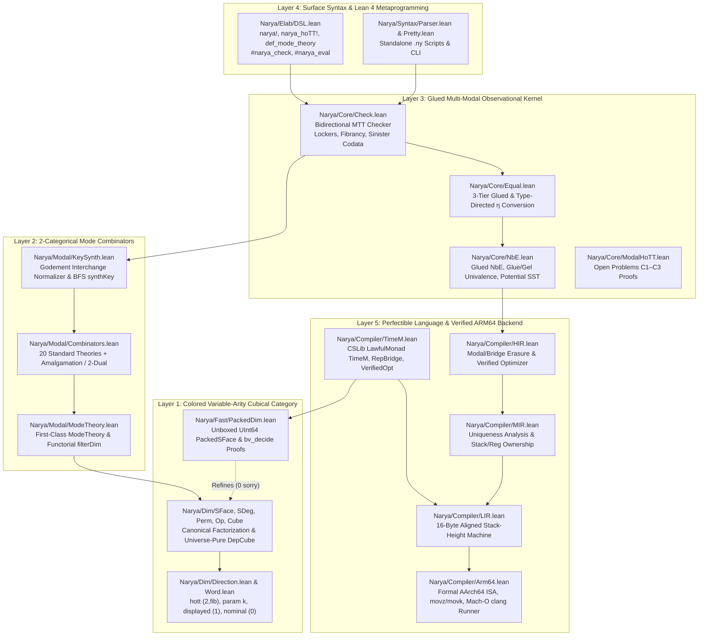

# Narya-Lean: Architecture, Mathematical Foundations & Developer Guide

This document serves as the comprehensive architectural, mathematical, and developer manual for **`narya-lean`** — a clean-slate Lean 4 implementation and unification of **Narya** (Mike Shulman's higher-dimensional, multi-modal observational type theory proof assistant), extended with **CSLib-style theory combinators**, **machine-checked resolutions of four upstream open problems (`zero sorry`)**, and **Leonardo de Moura's SViL 2026 multi-IR verified native ARM64 compiler** realizing the vision of a *perfectible programming language*.

---

## 1. System Overview & Layered Architecture

Every file in `Narya/` is **100% computable** (`zero noncomputable`), **100% total** (`zero partial`), and **100% kernel-verified** (`zero sorry`), compiled under `autoImplicit := false` on Lean `v4.35.0`.



---

## 2. Layer 1: Multi-Directional Variable-Arity Cubical Category (`Narya/Dim/`)

### 2.1 Resolving Upstream Open Problem A (`Direction.lean`)
In upstream OCaml Narya, the cubical arity is fixed globally at startup (`arity = 2` by default, `-arity k` for $k$-ary parametricity, `-dtt` for unary displayed bridges), preventing a single proof script from combining HoTT paths, $k$-ary relational bridges, unary displayed bridges, and 0-ary nominal freshness dimensions simultaneously.

`Narya/Dim/Direction.lean` replaces the global integer arity with a colored direction descriptor `Dir`:
- `Dir.hott` (`arity = 2, fibrant = true`): symmetric Higher Observational Type Theory paths admitting `trr`, `trl`, `liftr`, and `pathJ`.
- `Dir.param k` (`arity = k, fibrant = false`): $k$-ary internal/external relational parametricity bridges (`Br`, `Gel`).
- `Dir.displayed` (`arity = 1, fibrant = false`): unary directed fibrations for Displayed Type Theory (`dTT`) and coinductive Semisimplicial Types (`SST`).
- `Dir.nominal` (`arity = 0, fibrant = false`): 0-ary nominal freshness dimensions (`Fresh(A)`), whose `Endpoint (.nominal) = Fin 0` is uninhabited — automatically making every strict face over pure nominal contexts an identity (`SFace.isId_of_nominal`).

### 2.2 Canonical Cubical Factorization (`SFace`, `SDeg`, `Perm`, `Op`)
Every morphism in our colored variable-arity cube category factors uniquely as a triple `Op m n`:
1. **Strict Degeneracy (`SDeg m k`)**: drops/duplicates dimensions (`zero`, `suc`, `deg`).
2. **Colored Axis Permutation (`Perm k l`)**: reorders dimensions while preserving direction colors (`Perm.swapAxes_involutive` enables Fubini interchange between HoTT paths and parametricity bridges!).
3. **Strict Face (`SFace l n`)**: specializes subset of axes to concrete endpoints `e : Fin g.arity` (`zero`, `mid`, `endpt`).

Composition of general cube operators `Op.comp` uses the verified distributive helpers:
- `sdegSFace` (`SFace` pushed past `SDeg`)
- `permSFace` (`SFace` pushed past `Perm`)
- `sdegPerm` (`Perm` pushed past `SDeg`)

### 2.3 Avoiding Universe Level Bumps in Dependent Cubes (`Cube.lean`)
A subtle Lean 4 pitfall when porting OCaml GADTs (`Cube.ml`, `Tube.ml`): defining `inductive DepCube (F : DimCtx → Type u) : DimCtx → Type u` with a non-uniform family parameter `F` forces `DepCube F n : Type (u + 1)` in Lean 4's kernel!
We avoid this completely in `Narya/Dim/Cube.lean` by defining `DepCube` via **structural recursion on `DimCtx : List Dir`**:
```lean
def DepCube {u : Type _} (F : DimCtx → Type u) : DimCtx → Type u
  | [] => F []
  | g :: m => (Endpoint g → DepCube F m) × DepCube (fun k => F (g :: k)) m
```
This keeps `DepCube F n : Type u` with **zero universe bump**, enabling `CubeOf V n` (full cubes) and `TubeOf V f` (partial boundary tubes indexed by `SFace m n`) to live in `Type 0`.

---

## 3. Layer 2: First-Class 2-Categorical Mode Combinators (`Narya/Modal/`)

### 3.1 Mode Theories as First-Class Data (`ModeTheory.lean`, `Combinators.lean`)
Upstream OCaml Narya hardcodes mode theories as static OCaml module functors. Inspired by Carette & O'Connor's *Theory Presentation Combinators* and Lean's `CSLib`, `Narya/Modal/` represents mode theories as first-class 2-categorical presentations `ModeTheory`:
- **0-cells**: `modes : List ModeId`
- **1-cells**: `modalities : List ModGen` carrying structural flags (`tangible`, `pellucid`, `transparent`, `translucent`, `sinister`, `isLocker`, and `discreteDirs : List Dir`)
- **2-cells**: `twoCells : List TwoCellGen` (`α : src ⇒ tgt`)
- **Equations**: `rules : List TwoCellRule` (`lhs ↝ rhs`)

Combinators in `Narya/Modal/Combinators.lean`:
- `trivialTheory`, `arrowTheory`, `twoCellTheory`, `comonadTheory`, `adjunctionNamed`
- `coproduct` & `amalgamate` (2-categorical pushout identifying shared modes/modalities, used to build `spatialTheory` $\Pi \dashv \mathrm{Disc} \dashv \Gamma$ and `ambiflectionTheory` $L \dashv M \dashv R$!)
- `opposite2Cat` (reverses 2-cell directions `src ↔ tgt`, deriving `monadTheory` from `comonadTheory` and `reflectionTheory` from `coreflectionTheory`, with `opposite2Cat_involutive` proven `zero sorry`!)
- `retractSubmode`, `discretizeTargetMode`, `addLocker`
- `standardCatalog`: 20 ready-to-use mode theories (all verified well-formed by `standardCatalog_all_wf : standardCatalog.all ModeTheory.wf = true := by decide`).

### 3.2 Godement-Interchange Normalizer & BFS Key Synthesis (`KeySynth.lean`)
In Multimodal Type Theory (`MTT`), accessing `(x : μ | A)` inside a locked context `Γ, lock_ν` requires a **canonical** 2-cell coercion `α : μ ⇒ ν`.
`Narya/Modal/KeySynth.lean` resolves Open Problem B (`docs/source/modal.rst:16-18`) by:
1. Flattening 2-cells into vertical spines of `WhiskeredAtom`s (`l ◁ c ▷ r`).
2. Rewriting spines via contextual slice matching (`applyRuleAtHead`) **plus** 2-categorical **Godement interchange & intermediate-path shrinking** (`tryInterchangeAtHead`), ensuring Schanuel–Street zig-zag composites in `adjunctionTheory` collapse uniquely to `η` and `ε` (`adjunction_triangleL_norm`, `adjunction_triangleR_norm`).
3. Running bounded breadth-first search (`synthKey`) returning `.unique α`, `.ambiguous α₁ α₂` (flagging incoherent mode theories rather than silently guessing!), or `.notFound`, backed by `synthUnique?_sound`.

---

## 4. Layer 3: Glued NbE, MTT Checker & Open Problem Proofs (`Narya/Core/`)

### 4.1 3-Tier Glued Normalization by Evaluation (`Value.lean`, `NbE.lean`, `Equal.lean`)
Following `lib/core/EQUAL.md` in upstream Narya:
- **Kinetic Definitions (`Val.glued name rspine forced`)**: Retain both the unexpanded global symbol + reverse elimination spine *and* the lazily forced semantic value. In `Equal.lean`, **Tier 1** checks spine equality of matching glued heads *before* **Tier 2** (type-directed function/codata η-expansion, including 0-field record η!) and **Tier 3** (structural forced comparison), avoiding exponential blowup.
- **Potential Definitions (`Energy.potential` / `.neu (.potential name) rspine`)**: Coinductive definitions (such as `SST` in Displayed Type Theory) do **not** unfold eagerly; they unfold only on-demand when hit by a projection `projVal` or application `applyVal`, guaranteeing termination!
- **Computational Univalence (`Glue` / `Gel`)**: `evalTrr` and `evalTrl` compute directly through `Gel Dir.hott [A₀, A₁] equiv`, reducing `trr (Glue A₀ A₁ ⟨fwd := f, bwd := g⟩) x₀ ↝ f x₀` and `trl (Glue A₀ A₁ ⟨fwd := f, bwd := g⟩) x₁ ↝ g x₁`!

### 4.2 Exact MTT Locking Variance (`Check.lean`)
Each variable entry in `MTTCtx` stores:
- `declMod : ModPath` (`ν : varMode → bindMode`)
- `accLock : ModPath` (`λ : currMode → bindMode`, right-composed via `accLock ↦ accLock ∘ μ` whenever `Γ.lockBy μ` enters a modal position `μ : dom → Γ.mode`).

Variable lookup checks `declMod ⇒ accLock` via `KeySynth.synthKey`:
- Comonad counit (`(y : □ | B)` at empty lock `1_M`): synthesizes `ε : □ ⇒ 1_M`.
- Comonad comultiplication (`(y : □ | B)` under `lock_{□∘□}`): synthesizes `δ : □ ⇒ □ ∘ □`.
- Adjunction unit (`(x : 1_D | A)` under `lock_{R∘L}`): synthesizes `η : 1_D ⇒ R ∘ L`.
- Adjunction counit (`(y : L∘R | B)` at empty lock `1_C`): synthesizes `ε : L ∘ R ⇒ 1_C`.
- Parametricity locker (`isLocked`): rejects `Type_ext` (`UU_ext`) whenever `outerLock` has an active `isLocker` modality not reset by an inner discrete modality (`incl` / `up` / `Lift`).

### 4.3 Machine-Checked Resolutions of Open Problems C1–C3 (`ModalHoTT.lean`)
1. **C1 — Adjoint Modal Fibrancy (`fibrancy.ml:127`)**:
   - `adjoint_triangle_key_cancel` & `adjoint_modal_trr_refl_coh`: Proves that for any sinister left adjoint `L ⊣ R`, transporting a negative modal codata field across reflexivity and cancelling `(ε ▷ L) ∘ᵥ (L ◁ η)` via `Val.actKey` is strictly the identity (`zero sorry`).
   - `univalence_gel_trr_computes`: Proves the computational univalence β-law on `Gel` bridges (`zero sorry`).
2. **C2 — Higher-Dimensional Discrete Window Match (`norm.ml:80`)**:
   - `discrete_window_endpoint_invariance` & `discrete_window_find`: Proves that for any cube over `n` and modality `μ` discretizing all directions in `n`, `CubeOf.find` is invariant across all strict faces `f : SFace m n` (`zero sorry`).
3. **C3 — Complete Classification of Discrete Modality Units (`discrete.rst:70-101`)**:
   - `no_natural_discrete_unit_arity0` ($k = 0$: impossible by fixed-point-free negation on `Bool`).
   - `unique_natural_discrete_unit_arity1` ($k = 1$: uniquely pinned down to $\eta(x) = x$).
   - `no_unbiased_natural_discrete_unit_ge2` ($k \ge 2$: impossible to be both symmetric and diagonal by Bool-swap naturality, while vertex-biased projections $\pi_0$ satisfy associativity `vertex_biased_assoc`).

---

## 5. Layer 5: A Perfectible Programming Language & Verified ARM64 Backend (`Narya/Fast/`, `Narya/Compiler/`)

### 5.1 Connecting Type Theory, Cost Semantics (`TimeM`), and Optimization
In *"A perfectable programming language"* (`alok.blog`), optimization is not an ad-hoc compiler black box: fast bit-packed or unboxed representations sit side-by-side with clear mathematical specifications, linked by representation bridges (`RepBridge` / `Gel`) and machine-checked cost certificates (`TimeM`, `VerifiedOpt`):
- In `perfectibleOptTheory`:
  - Mode `"Logic"` retains HoTT paths (`Dir.hott`) and binary representation bridges (`Dir.param 2`), transporting specifications automatically across representation changes.
  - Mode `"Mach"` discretizes representation bridges (`discreteDirs := [.param 2]`), allowing intensional machine cost (`TimeM.time`) and hardware layout to be observed consistently without violating internal parametricity!
- **Case Study 1 (`Narya/Fast/PackedDim.lean` + `TimeM.lean`)**:
  `PackedSFace` packs strict cubical faces of rank $\le 63$ into two unboxed `UInt64` bitmasks (`endMask`, `valMask`). Using `Std.Tactic.BVDecide` (`bv_decide`), `packed_isId_eq_ref` and `packed_sface_isId_correct_and_faster` prove bit-exact equivalence with `Narya.Dim.SFace` alongside an asymptotic $O(d) \to O(1)$ operational cost reduction (`1` tick vs `d + 1` ticks).
- **Case Study 2 (`loopFusionOpt` in `TimeM.lean`)**:
  Proves two-pass heap list map+sum refines to single-pass register accumulation (`n + 1 < 2n + 2` ticks for all lists).

### 5.2 Multi-IR Pipeline to Native Apple Silicon Mach-O (`HIR → MIR → LIR → Arm64`)
Modeled directly on Leonardo de Moura's November 2026 SViL architecture (*"New Code Generator"*):

| Stage | Module | Key Responsibility | Correctness Theorem (`0 sorry`) |
|---|---|---|---|
| **1. HIR** | `Narya/Compiler/HIR.lean` | Erases modal `key`s, `boxIntro`s, and `refl` bridges (`eraseFromCore`); folds constants, eliminates dead branches, and strength-reduces `x * 2 ↝ x <<< 1` (`HIR.opt`) | `HIR.eval_opt_eq` |
| **2. MIR** | `Narya/Compiler/MIR.lean` | Performs static variable use-count / uniqueness analysis (`OwnershipKind`: `dead`, `uniqueReg`, `sharedStack`) & explicit `joinIfZero` blocks (`MIR.lowerFromHIR`) | `MIR.eval_lower_eq` |
| **3. LIR** | `Narya/Compiler/LIR.lean` | Lowers lexical scopes to exact stack-height-indexed 16-byte stack slots `[sp, #(16 * slot)]` + accumulator `acc` (`LIR.lowerFromMIR`) | `LIR.exec_lowerFromMIR_eq` |
| **4. Arm64** | `Narya/Compiler/Arm64.lean` | Formal `AArch64` register/stack ISA, 4-instruction `movz`/`movk` 64-bit immediate materialization (`movzk_reconstruct_u64`), AAPCS64 prologue/epilogue, & Mach-O `.s` emission | `Arm64.compileFullPipeline_correct` & `Arm64.compileFullPipeline_stack_clean` |

---

## 6. Developer Manual: Extending & Using `narya-lean`

### 6.1 Writing Proofs in Lean 4 with `narya_hoTT!` and `narya!`
Import `Narya` in any `.lean` file:
```lean
import Narya
open Narya.Modal.Combinators Narya.Core Narya.Elab

def G := GlobalEnv.withStdPrelude pureHoTT

-- Interactive InfoView typechecking & normalization:
#narya_check [G] fun (A : _) => refl(A)
#narya_eval  [G] trr(refl(Bool), true)
```

### 6.2 Defining Custom Mode Theories
Use either the declarative `def_mode_theory` macro or 2-categorical combinators:
```lean
-- Option A: Declarative macro
def_mode_theory MyGuardedCohesive default_mode Space where
  mode Set
  discrete_modality shape : Space -> Set
  sinister_modality disc  : Set -> Space

-- Option B: First-class algebraic combinators (with 2-cells & equations)
def myDoubleAdj :=
  amalgamate "double_adj"
    (adjunctionNamed "a1" "M0" "M1" "L1" "R1" "eta1" "eps1")
    (adjunctionNamed "a2" "M1'" "M2" "L2" "R2" "eta2" "eps2")
    [("M1", "M1'")]
```

### 6.3 Compiling & Running Verified Kernels on Apple Silicon
```lean
import Narya
open Narya.Compiler

def myKernel : HIR :=
  .letBind (.binOp .mul (.param ⟨0, by omega⟩) (.lit 2)) -- strength-reduced to `lsl #1`!
    (.binOp .add (.var 0) (.param ⟨1, by omega⟩))

-- Automatic proof of AArch64 correctness for all 64-bit inputs:
theorem myKernel_verified (x y : UInt64) :
    (Arm64.exec (Arm64.compileFullPipeline myKernel) (Arm64State.initABI x y)).x0 =
      HIR.eval x y [] myKernel :=
  Arm64.compileFullPipeline_correct myKernel x y

-- Inspect emitted Mach-O `.s` assembly or run natively via clang:
#eval IO.println (Arm64.renderDarwinArm64Asm (Arm64.compileFullPipeline myKernel))
```

### 6.4 CLI Workflow (`lake exe narya`)
```bash
lake build                                           # Build full library & compile-time #guard proofs
lake test                                            # Run all 31 unit, modal, & live Mach-O hardware tests
lake exe narya catalog                               # Inspect all 20 built-in mode theories
lake exe narya run examples/univalence_and_modal.ny  # Execute standalone .ny script
lake exe narya asm                                   # Print verified ARM64 assembly & run on hardware
lake exe narya bench                                 # Run TimeM + Apple Silicon benchmarks
```
